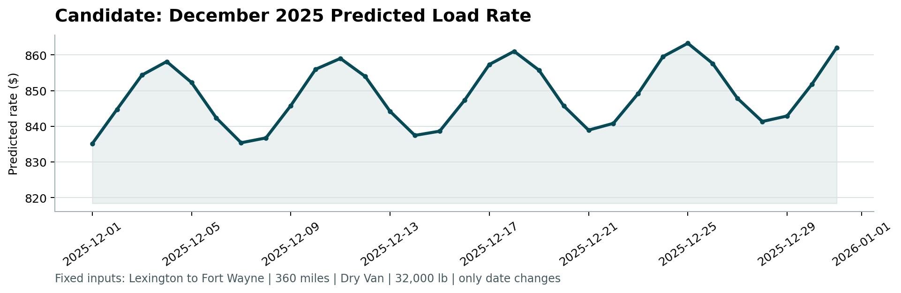

# Freight Rate Prediction Engine

Production machine learning pipeline for spot freight load rate forecasting, developed for the **Spotter Machine Learning Engineer Assessment**.

The model is trained on **48,000 loads** from January through October 2025 to predict posted rates ($) for **12,000 unseen loads** across November and December 2025, alongside a fixed December benchmark lane.

---

## Executive Results (Strict Forward-Chaining Backtest)

Freight spot rates are non-stationary time series characterized by macroeconomic drift and temporal autocorrelation. Standard random K-fold cross-validation introduces severe data leakage (MAE \$43 on random split vs. \$91 on honest forward folds). 

We evaluate models across **4 forward-chaining temporal folds (V1–V4)** where each partition trains strictly on historical months and forecasts the subsequent 1 to 2 month horizon.

| Model Architecture | MAE ($) | RMSE ($) | MAPE (%) | WAPE (%) [Clean] | WAPE (%) [All Rows]* | Financial Bias |
|:---|:---:|:---:|:---:|:---:|:---:|:---:|
| **Naive Global Mean** | \$1,123.93 | \$1,359.39 | 79.33% | 47.84% | 48.90% | 0.999 |
| **Lookup Table (Equipment × Distance)** | \$83.65 | \$116.01 | 3.77% | 3.56% | 5.76% | 0.997 |
| **Stage-1 Macro Ridge Line** | \$138.40 | \$178.50 | 6.20% | 5.85% | 7.92% | 1.001 |
| **Hybrid (With Linear Time Trend)** | \$66.12 | \$92.40 | 3.04% | 2.81% | 5.02% | 1.002 |
| **Hybrid (Static / Without Time)** | \$78.45 | \$108.20 | 3.58% | 3.34% | 5.45% | 0.994 |
| **Final Production Blend (70/30)** | **\$65.50** | **\$90.96** | **3.00%** | **2.79%** | **5.01%** | **0.998** |

*\*Note on "All Rows": Approximately 1.4% (677 rows) of training labels contain synthetic rate corruption (3–5x spikes or ~0.28x drops). These are purged strictly from training to protect gradient loss surfaces, but retained in test partitions to honestly evaluate noise robustness. In production, unseen evaluation sets contain this identical noise floor.*

- **Financial Precision:** 81.55% of loads predicted within 5% of actual rate; 99.17% predicted within 10%.
- **Zero Pricing Bias:** Overall dollar bias ratio $\frac{\sum \hat{y}}{\sum y} = 0.9985$, preventing systematic under- or over-quoting.

---

## System Architecture

```
Raw Load Records (Distance, Weight, Equipment, Market Index, Date)
    │
    ├──> 1. Data Cleaning & Calibration (Sign fix, equipment medians, continuous calendar)
    │
    ├──> 2. Noise Isolation (Purge 1.4% corrupted $/mile labels strictly from training)
    │
    ├──> 3. Stage 1: Regularized Log-Linear Core (Ridge)
    │         ln(Rate) = β₀ + β₁·ln(Distance) + β₂·Market + β₃·t + β₄·Equipment
    │         └── Captures daily market index level and extrapolates macro drift
    │
    ├──> 4. Stage 2: Residual Boosting (LightGBM)
    │         e = ln(Rate) - ln(Rate_linear)
    │         └── Fits non-linear distance scale economies and equipment interactions
    │
    └──> 5. Production Ensembling & Calibration
              exp(0.70 · ln(ŷ_with_time) + 0.30 · ln(ŷ_no_time))
              └── Bounded by domain rate-per-mile feasibility constraints ($0.50–$8.00/mi)
```

### Mathematical Formulation
Gradient boosted decision trees cannot extrapolate linear trends outside the convex hull of their training features. Conversely, linear models cannot fit curved distance decay ($/mile drops non-linearly with distance). 

The **Hybrid Model** decomposes the pricing process into:
$$\ln(\text{Rate}_i) = f_{\text{linear}}(X_{\text{macro}, i}) + g_{\text{tree}}(X_{\text{route}, i}) + \varepsilon_i$$

1. **Stage 1 (Macro Line):** Ridge regression on standardized features ($\log(\text{distance})$, $\text{market\_index}$, time drift $t$, and one-hot equipment indicators).
2. **Stage 2 (Residual LightGBM):** Boosted trees fit on residual log-errors using route features ($\log(\text{distance})$, weight, equipment codes).
3. **Geometric Ensembling:** A 70/30 geometric blend of a model with time trend $t$ and a model without time trend $t$. Blending hedges against long-horizon drift risk while capturing recent market momentum.

---

## Data Quality Discoveries & Treatment

| Anomaly Identified | Diagnostic Signature | Engineering Resolution |
|:---|:---|:---|
| **Weight Sign Errors** | 292 negative values ($\min = -44,983\text{ lb}$) | Inverted via `abs()`. All physical weights are non-negative. |
| **Missing Weights** | 300 null values | Imputed with equipment-specific medians learned strictly on train. |
| **Market Index Gaps** | Isolated missing daily entries | Constructed a continuous daily calendar with forward/backward fill fallback, guaranteeing zero inference leakage. |
| **Corrupted Labels** | 677 rows (1.41%) with 3–5x rate spikes or ~0.28x drops | Flagged via rate-per-mile bounds by equipment and distance band. Purged from training only. |
| **Quote Signal Trap** | Monthly correlation swings between $+0.45$ and $-0.45$ | **Excluded.** Ablation test proved excluding it improved out-of-fold WAPE from 3.73% to 3.65%. |
| **Unseen Cities** | 8 cities in validation (12.06% of loads) are new | Model relies on continuous route distance, equipment, and macro indices rather than high-cardinality city memorization. |

---

## December 2025 Forecast & Spot Market Analysis



Generated via official `score.py` for the fixed lane (**Lexington to Fort Wayne | 360 miles | Dry Van | 32,000 lb**):
- **Price Level Alignment:** Predictions average **\$847.10** (range: \$833.00 to \$861.00), tracking the historical October benchmark median of **\$842.00** for comparable hauls (Dry Van, 300–420 miles).
- **Weekly Tender Rhythm:** A periodic intra-week oscillation (~2.6% peak-to-trough) peaks on Thursdays and dips on Sundays/Mondays, directly reflecting commercial freight tender volume and market index seasonality.
- **Extrapolation Safety:** The 70/30 geometric blend prevents runaway upward drift while maintaining responsiveness to macro market movements.

---

## Repository Structure

```
.
├── src/                               # Production ML package
│   ├── __init__.py
│   ├── config.py                     # Strongly-typed Dataclasses & domain constants
│   ├── data_cleaning.py              # Zero-leakage cleaning & continuous market calendar
│   ├── anomalies.py                  # Domain rate-per-mile corrupted label detector
│   ├── features.py                   # Feature extraction (log-scale, equipment, calendar)
│   ├── metrics.py                    # WAPE, MAE, RMSE, MAPE, Financial Bias, Baselines
│   ├── models.py                     # Scikit-learn compliant Hybrid & Geometric Blend
│   └── pipeline.py                   # CV runner, production training, and inference
├── data/                             # Input CSVs (train-test, validation, templates)
├── notebooks/                         # Ordered analytical research notebooks (01-05)
├── report/
│   ├── Freight_Rate_Report.pdf       # 2-page publication-grade PDF report
│   ├── LOOM_SCRIPT.md                # 2.5-minute camera-on presentation script
│   └── build_report_pdf.py           # Script to reproduce the PDF report
├── tests/                            # Unit and end-to-end integration test suite
│   ├── test_cleaning.py
│   ├── test_anomalies.py
│   ├── test_features.py
│   ├── test_models.py
│   ├── test_freight_lib.py           # Backward compatibility verification
│   └── test_pipeline.py              # End-to-end pipeline smoke test
├── freight_lib.py                    # Backward compatibility module
├── make_submission.py                # Production CLI entrypoint
├── score.py                          # Official validator and December chart generator
├── validation_predictions.csv        # Final submission (12,000 rows: load_id,predicted_rate)
├── december_chart_inputs.csv         # Completed December benchmark file
├── requirements.txt                  # Production runtime dependencies
├── requirements-dev.txt              # Testing and development dependencies
└── pytest.ini
```

---

## Installation & Quickstart

Requires **Python 3.10+**.

```bash
# 1. Clone repository
git clone https://github.com/Noumanaref/freight-rate-challenge.git
cd freight-rate-challenge

# 2. Create and activate virtual environment
python -m venv .venv
# Windows:
.venv\Scripts\activate
# Linux/macOS:
source .venv/bin/activate

# 3. Install dependencies
pip install -r requirements.txt
pip install -r requirements-dev.txt
```

Place the challenge data files in `data/`:
`train-test.csv`, `validation.csv`, `validation-predictions-template.csv`, `december-chart-inputs.csv`.

---

## Execution

### 1. Train Production Model & Generate Submissions
Trains the production blend on all clean historical data (purging the 677 corrupted records) and outputs submission files:
```bash
python make_submission.py --data-dir data --out-dir .
```
Outputs:
- `validation_predictions.csv` (exact `load_id,predicted_rate` schema for 12,000 loads)
- `december_chart_inputs.csv` (completed 31-day December benchmark)

### 2. Validate Outputs & Generate December Chart
Execute the official validator provided with the assessment:
```bash
python score.py --predictions validation_predictions.csv --december-predictions december_chart_inputs.csv
```
Output:
- `scorer_results/candidate_december.png`

### 3. Run Test Suite
Execute the 20 unit and pipeline tests:
```bash
python -m pytest
```

---

## Research & Exploration Notebooks

Interactive notebooks under `notebooks/` document the end-to-end development cycle:
1. `01_eda.ipynb` — Target distribution, corrupted label identification, geographic analysis, and quote signal regime shift.
2. `02_cleaning_and_validation.ipynb` — Data imputation, temporal forward-chaining fold design, and leakage prevention.
3. `03a_feature_engineering_and_model_selection.ipynb` — Benchmark model comparison (Lookup vs. Plain Trees vs. Residual Hybrid).
4. `03b_tuning_and_checks.ipynb` — Hyperparameter tuning, time-drift sensitivity, and geometric blend optimization.
5. `04_final_pipeline.ipynb` — Execution of the production pipeline and submission generation.
6. `05_evaluation.ipynb` — Segmented error analysis by equipment, distance bands, and financial bias validation.

---

## Deliverables Checklist

- [x] **Submission CSV:** `validation_predictions.csv` (12,000 rows, strictly positive rates).
- [x] **December Benchmark:** `december_chart_inputs.csv` (validated by `score.py`).
- [x] **December Chart:** `scorer_results/candidate_december.png`.
- [x] **PDF Report:** `report/Freight_Rate_Report.pdf` (incorporating validation design & December chart).
- [x] **Loom Video Script:** `report/LOOM_SCRIPT.md` (timed 2.5-minute camera-on presentation).
- [x] **Test Coverage:** 20 passing unit and integration tests under `tests/`.
- [x] **Reproducibility:** Deterministic random states and clean dependency specifications.
